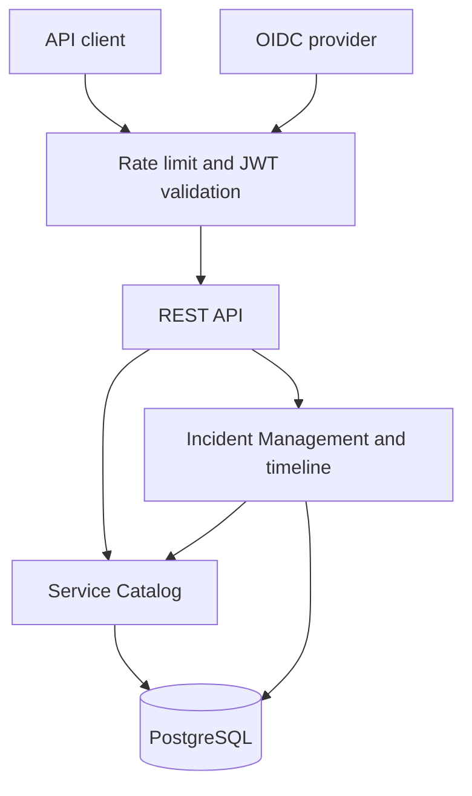

# RheinOps Platform

[](https://github.com/ahmadkadri978/rheinops-platform/actions/workflows/ci.yml)
[](https://openjdk.org/projects/jdk/21/)
[](https://spring.io/projects/spring-boot)
[](LICENSE)

RheinOps is a production-oriented service operations and incident management API. It is designed to demonstrate backend engineering and support-engineering skills through an executable system: clear module boundaries, safe incident state transitions, observable runtime behaviour, reproducible infrastructure, and automated quality checks.

**Kurzbeschreibung (DE):** Eine nachvollziehbar dokumentierte Plattform zur Verwaltung von Services und Störungen, gebaut mit Java, Spring Boot, PostgreSQL, Docker und CI/CD.

> **Current milestone:** OIDC/JWT authentication, role-based authorisation, an immutable incident timeline, and bounded API rate limiting are implemented. SLA workflows and the operations dashboard remain deliberately tracked as later milestones rather than presented as finished work.

## Why this project exists

Generic CRUD demos do not show how software behaves under operational pressure. RheinOps focuses on the engineering concerns that matter when a service is degraded:

- validated lifecycle transitions and optimistic concurrency;
- least-privilege OIDC roles and audience-bound JWT validation;
- append-only incident history with an identity snapshot for every action;
- correlation IDs and consistent RFC 9457-style problem responses;
- database migrations and schema validation;
- health, readiness, liveness, and Prometheus metrics;
- integration tests against real PostgreSQL;
- pull-request-driven delivery with repeatable CI.

## Architecture

RheinOps starts as a modular monolith. This keeps deployment simple while Spring Modulith verifies boundaries that can support later extraction if scale or ownership requires it.



| Module | Responsibility | Depends on |
|---|---|---|
| `servicecatalog` | Registered services and their operational status | `shared` |
| `incident` | Incident reporting, filtering, and lifecycle transitions | `servicecatalog`, `shared` |
| `shared` | Security boundary, actor context, problem details, pagination, and request correlation | — |

See [Architecture](docs/architecture.md) and [ADR-0001](docs/adr/0001-modular-monolith.md) for the rationale and trade-offs.

## Technology stack

- Java 21 and Spring Boot 4.0.7
- Spring Web MVC, Validation, Data JPA, Actuator, and Modulith
- Spring Security OAuth2 Resource Server and Keycloak 26.7.1
- Bucket4j with a bounded Caffeine cache for per-instance API rate limiting
- PostgreSQL 17 and Flyway migrations
- Testcontainers for database integration tests
- OpenAPI/Swagger UI and Micrometer Prometheus metrics
- Docker multi-stage builds and Docker Compose
- GitHub Actions, Maven Failsafe, and JaCoCo

## Run locally

Requirements: Docker with Compose v2.

```bash
git clone https://github.com/ahmadkadri978/rheinops-platform.git
cd rheinops-platform
docker compose up --build
```

Then open:

- Swagger UI: <http://localhost:8080/swagger-ui.html>
- OpenAPI JSON: <http://localhost:8080/api-docs>
- Health: <http://localhost:8080/actuator/health>
- Prometheus metrics: <http://localhost:8080/actuator/prometheus>
- Keycloak administration: <http://localhost:8090/admin/>

Stop the stack with `docker compose down`. Use `docker compose down -v` only when you intentionally want to delete the local database volume.

### Obtain a local access token

The imported realm contains four local-only demonstration accounts. Their committed passwords are intentionally disposable and must never be reused outside this development stack.

| Username | Password | Role |
|---|---|---|
| `viewer` | `viewer-demo` | `VIEWER` |
| `responder` | `responder-demo` | `RESPONDER` |
| `incident-manager` | `manager-demo` | `INCIDENT_MANAGER` |
| `administrator` | `administrator-demo` | `ADMINISTRATOR` |

Request a responder token:

```bash
curl -s -X POST http://localhost:8090/realms/rheinops/protocol/openid-connect/token \
  -H 'Content-Type: application/x-www-form-urlencoded' \
  -d 'client_id=rheinops-cli' \
  -d 'grant_type=password' \
  -d 'username=responder' \
  -d 'password=responder-demo'
```

The direct password grant exists only to make the local CLI demonstration reproducible. A production UI must use Authorization Code with PKCE instead.

## Authorisation model

| Capability | Viewer | Responder | Incident manager | Administrator |
|---|:---:|:---:|:---:|:---:|
| Read services, incidents, and timelines | ✓ | ✓ | ✓ | ✓ |
| Report and transition incidents | — | ✓ | ✓ | ✓ |
| Register managed services | — | — | ✓ | ✓ |
| Read Prometheus metrics | — | — | — | ✓ |

Tokens must have the configured issuer, the `rheinops-api` audience, and a recognised role in `realm_access.roles`. Unknown roles grant no RheinOps authority.

## API overview

| Method | Endpoint | Purpose |
|---|---|---|
| `POST` | `/api/v1/services` | Register a managed service |
| `GET` | `/api/v1/services` | List managed services |
| `GET` | `/api/v1/services/{id}` | Get one managed service |
| `POST` | `/api/v1/incidents` | Report an incident |
| `GET` | `/api/v1/incidents` | Filter incidents by status and severity |
| `GET` | `/api/v1/incidents/{id}` | Get one incident |
| `PATCH` | `/api/v1/incidents/{id}/status` | Transition an incident with an expected version |
| `GET` | `/api/v1/incidents/{id}/timeline` | Read the immutable actor-attributed timeline |

Example:

```bash
curl -i -X POST http://localhost:8080/api/v1/services \
  -H 'Authorization: Bearer <incident-manager-token>' \
  -H 'Content-Type: application/json' \
  -H 'X-Correlation-ID: demo-001' \
  -d '{"name":"Customer Portal","slug":"customer-portal","description":"Customer account portal"}'
```

Every response contains `X-Correlation-ID`. Error responses include the same identifier so an operator can connect a user report to server logs.

## Tests and quality checks

```bash
# Fast unit and architecture tests
./mvnw test

# Full build, including PostgreSQL integration tests (Docker required)
./mvnw verify
```

CI runs the full verification suite and builds the production container. Integration tests exercise the role matrix, a complete incident workflow, stale-update rejection, PostgreSQL migrations, actor attribution, and database-level audit immutability.

## Production security profile

Activate `prod` with `SPRING_PROFILES_ACTIVE=prod`. The profile requires explicit issuer and JWK Set environment variables, disables OpenAPI/Swagger, exposes no health details, keeps sessions stateless, and denies every route that is not explicitly authorised. TLS is expected to terminate at a trusted ingress or reverse proxy. See the [threat model](docs/security/threat-model.md) before deployment.

## Delivery roadmap

1. **Foundation and incident core** — complete.
2. **Security and auditability** — current milestone.
3. **Support engineering** — SLA policies, escalation rules, runbooks, and searchable diagnostics.
4. **Reliability** — Prometheus/Grafana dashboards, alert rules, load tests, and failure drills.
5. **Portfolio demo** — deployed environment, seeded scenario, screenshots, and a short technical walkthrough.

The detailed backlog and acceptance criteria live in [the roadmap](docs/roadmap.md).

## Engineering decisions

Architecture decisions are recorded under [`docs/adr`](docs/adr). Known limitations are documented instead of hidden, and each milestone is intended to land through a reviewable pull request.

## Contributing and security

See [CONTRIBUTING.md](CONTRIBUTING.md) for the local workflow. Please report security issues according to [SECURITY.md](SECURITY.md).

## License

Licensed under the [MIT License](LICENSE).
