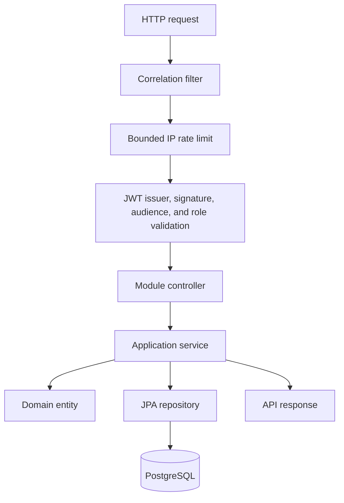
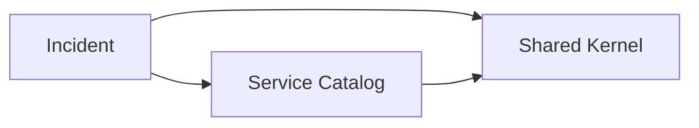

# Architecture

## Context

RheinOps supports operators who register customer-facing services and manage incidents from report to resolution. The first release optimises for a clear domain model, reliable local setup, and operational diagnosis rather than distributed-system complexity.

## System shape

The application is a Spring Modulith modular monolith backed by PostgreSQL. Modules communicate through explicit public APIs in their root packages; persistence entities and web DTOs remain internal.

## Module dependency rules

- `incident` stores the affected service ID and resolves it through `ServiceCatalog`; it does not import the service catalog's JPA entity.
- Flyway owns the database schema. Hibernate validates the mapping but never mutates production schema.
- Spring Modulith's architecture test detects cycles and illegal access to internal packages.

## Runtime and observability

- Every HTTP request receives a bounded, validated correlation ID.
- Actuator provides health, liveness, readiness, and Prometheus endpoints.
- PostgreSQL state is retained in a named Compose volume.
- The application shuts down gracefully and disables Open Session in View.
- API requests are rate limited before bearer-token processing; health probes are excluded.

## Consistency model

Incident updates use two guards:

1. the API caller supplies `expectedVersion`, producing a clear conflict response for stale state;
2. JPA `@Version` protects against a race between concurrent transactions.

This is intentionally stricter than last-write-wins because conflicting incident updates can mislead responders.

## Security boundary

RheinOps is an OAuth2 Resource Server. It validates JWT signature, expiry, not-before time, exact issuer, and the `rheinops-api` audience. Only the explicit Keycloak realm roles `VIEWER`, `RESPONDER`, `INCIDENT_MANAGER`, and `ADMINISTRATOR` are mapped to authorities; unrelated realm roles are ignored.

The HTTP policy is deny-by-default. Liveness and readiness remain anonymous and contain no component details. Application data requires at least `VIEWER`; incident writes require `RESPONDER`; service registration requires `INCIDENT_MANAGER`; Prometheus requires `ADMINISTRATOR`. Sessions, form login, HTTP Basic, cross-origin support, and multipart uploads are disabled.

Local Compose imports a reproducible Keycloak realm and disposable demo users. Production uses externally supplied issuer and JWK Set addresses, disables API documentation, and expects TLS termination at a trusted ingress. Direct password grants are a local demonstration convenience, not the production authentication flow.

## Audit invariants

Creating an incident appends `INCIDENT_CREATED`; every real status change appends `STATUS_CHANGED`. Each entry stores the identity-provider subject, the display name at action time, the previous and new states, and a UTC timestamp. The incident update and timeline append occur in one database transaction.

The timeline has no update or delete API, its Hibernate mapping is immutable, and PostgreSQL rejects row-level `UPDATE` and `DELETE` through a trigger. A database owner can still disable triggers or rewrite storage; protecting against a compromised database administrator requires external immutable export in a later milestone.

## Rate-limit scope

Bucket4j uses a token bucket keyed by the direct network peer address. Caffeine bounds the number of cached client buckets and expires inactive entries, preventing an attacker from causing an unbounded in-memory map. This implementation is intentionally per-instance. A multi-replica deployment must move the limit to a trusted gateway or a distributed Bucket4j backend before claiming a global quota.
