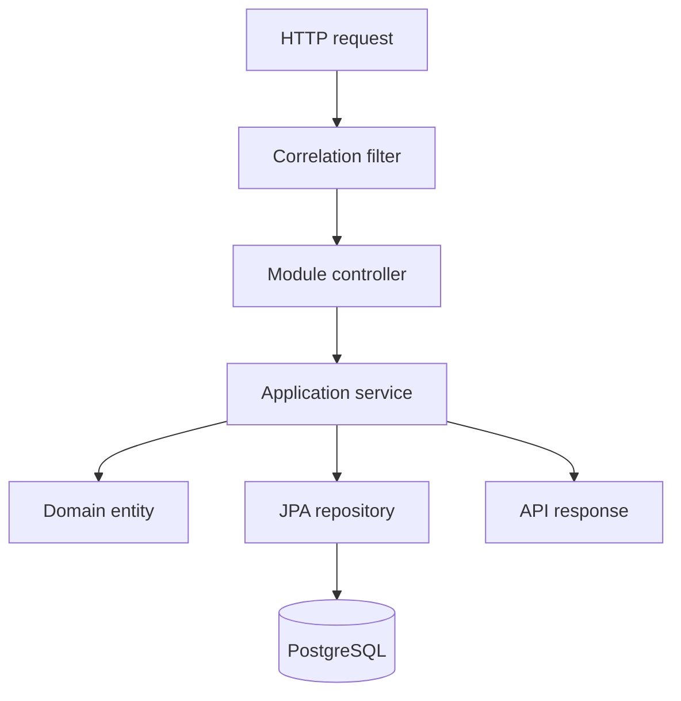
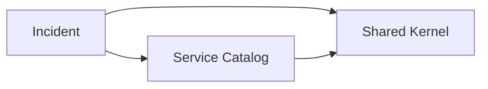

# Architecture

## Context

RheinOps supports operators who register customer-facing services and manage incidents from report to resolution. The first release optimises for a clear domain model, reliable local setup, and operational diagnosis rather than distributed-system complexity.

## System shape

The application is a Spring Modulith modular monolith backed by PostgreSQL. Modules communicate through explicit public APIs in their root packages; persistence entities and web DTOs remain internal.

## Module dependency rules

- `incident` stores the affected service ID and resolves it through `ServiceCatalog`; it does not import the service catalog's JPA entity.
- Flyway owns the database schema. Hibernate validates the mapping but never mutates production schema.
- Spring Modulith's architecture test detects cycles and illegal access to internal packages.

## Runtime and observability

- Every HTTP request receives a bounded, validated correlation ID.
- Actuator provides health, liveness, readiness, and Prometheus endpoints.
- PostgreSQL state is retained in a named Compose volume.
- The application shuts down gracefully and disables Open Session in View.

## Consistency model

Incident updates use two guards:

1. the API caller supplies `expectedVersion`, producing a clear conflict response for stale state;
2. JPA `@Version` protects against a race between concurrent transactions.

This is intentionally stricter than last-write-wins because conflicting incident updates can mislead responders.

## Security boundary

The current milestone has no authentication and must not be exposed publicly. Milestone 2 will add OIDC/JWT authentication, role-based authorisation, and an immutable audit timeline before any public deployment.
