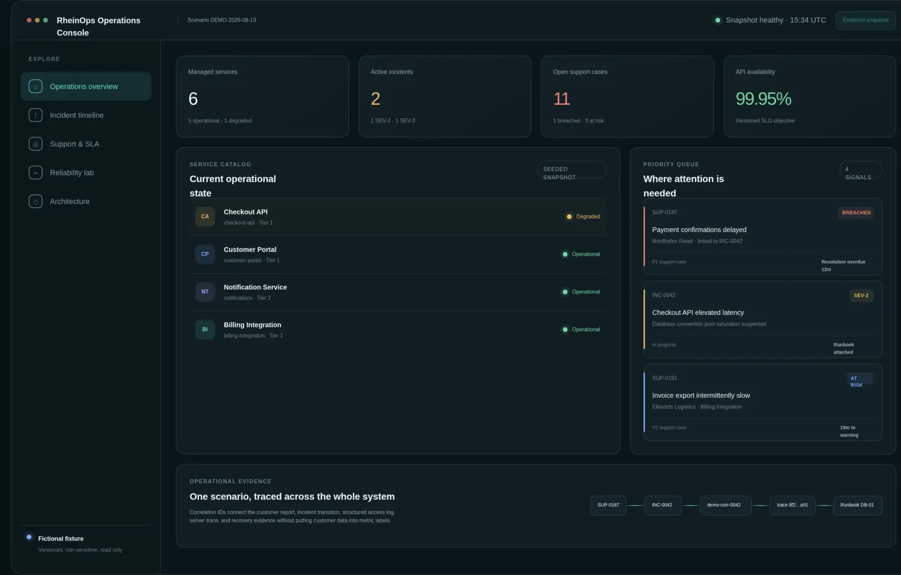
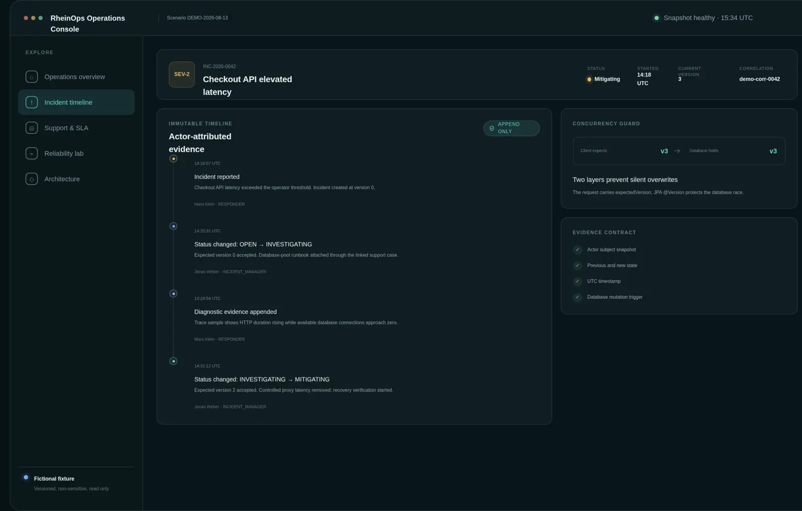
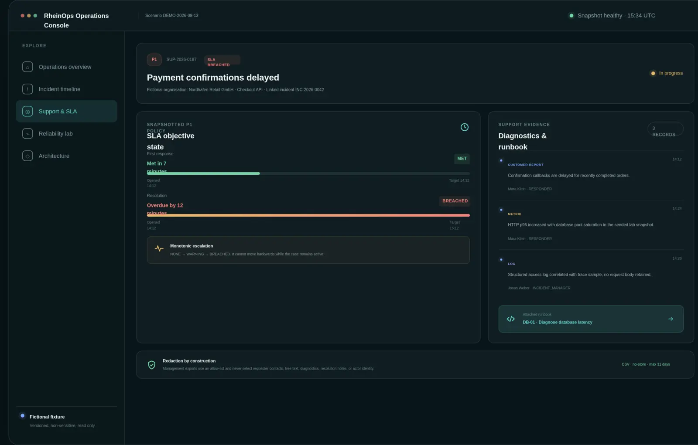
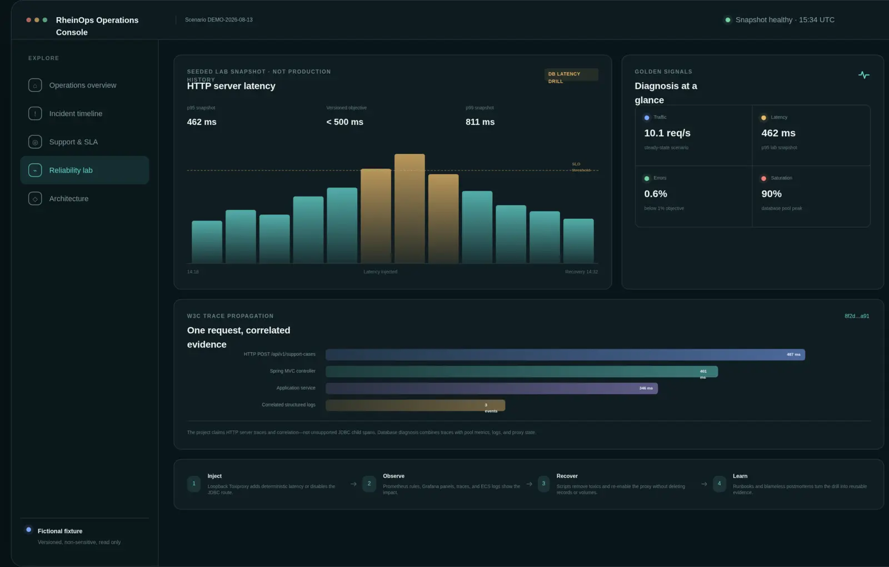
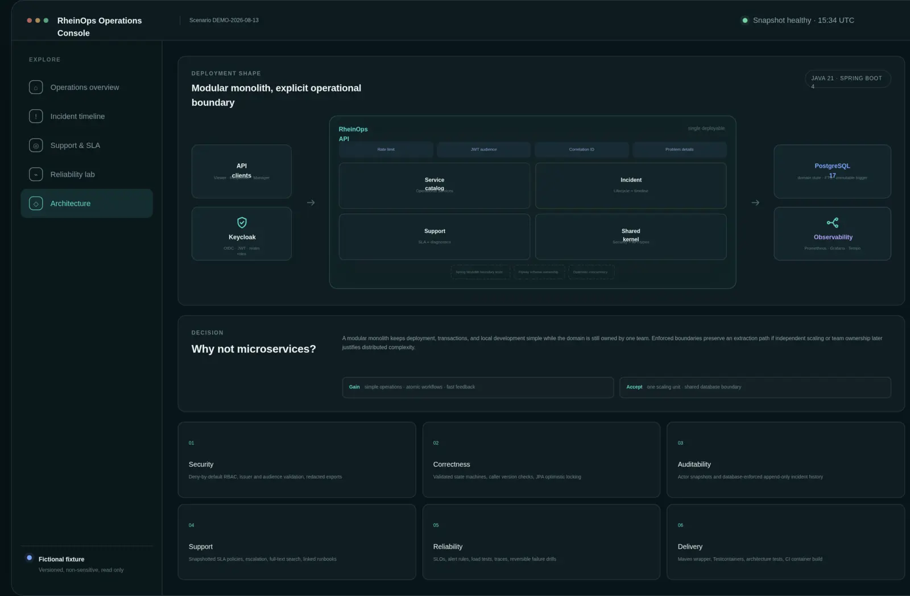

# RheinOps portfolio release

RheinOps is presented as an evidence-led backend and support-engineering case study. The public console is a read-only explanation layer over the repository: it uses one deterministic, fictional incident scenario so a reviewer can understand the system without credentials, customer data, or a running production API.

[Open the public interactive demo](https://rheinops-portfolio-demo.kadriahmad59.chatgpt.site) · [Follow the three-minute walkthrough](walkthrough.md) · [Read the CV case study](cv-case-study.md)

## What a reviewer can inspect

| Claim | Visible demonstration | Executable repository evidence |
|---|---|---|
| Safe incident updates | Versioned incident timeline and concurrency guard | `IncidentEntity`, `IncidentService`, and PostgreSQL integration tests |
| Auditable operations | Actor-attributed, append-only timeline | Flyway `V2`, immutable entity mapping, database-trigger tests |
| Support engineering | SLA state, escalation, diagnostics, and runbook link | `support` module, `SupportWorkflowIT`, and ADR-0003 |
| Security boundary | OIDC roles, audience validation, deny-by-default access | Security configuration and `SecurityIntegrationIT` |
| Reliability practice | SLO snapshot, traces, golden signals, and failure drill | Prometheus rules, k6, Toxiproxy scripts, runbooks, and postmortems |
| Delivery discipline | Java, PostgreSQL, Docker, and CI proof panel | Maven verification, Testcontainers, Compose validation, and image build |

## Screenshot gallery

| Operations overview | Incident evidence |
|---|---|
|  |  |

| Support and SLA | Reliability lab |
|---|---|
|  |  |

| Architecture console |
|---|
|  |

## Demo safety contract

- All names, organisations, identifiers, metrics, traces, timestamps, and operational events are fictional fixtures.
- The console is read-only and contains no credentials, personal data, production telemetry, or live customer history.
- Numerical values are scenario snapshots, not performance benchmarks or claims about a production deployment.
- The source repository remains the authority for implemented behaviour; the console links each explanation to inspectable evidence.

The full fixture contract is documented in [demo-scenario.md](demo-scenario.md). The system-level delivery boundary is available as [an SVG architecture diagram](assets/system-architecture.svg).
