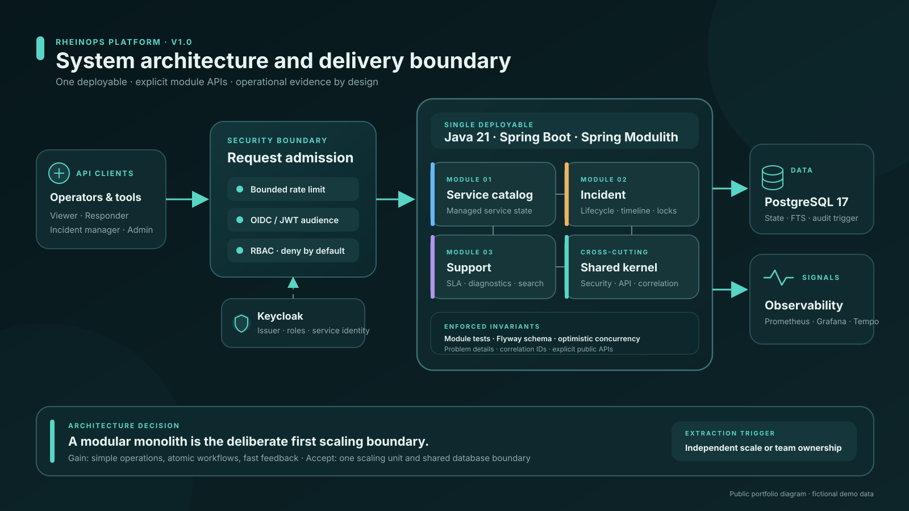

# RheinOps — CV and interview case study

## 30-second positioning

RheinOps is a production-oriented service-operations backend built with Java 21, Spring Boot, PostgreSQL, Docker, and GitHub Actions. It demonstrates secure incident workflows, immutable audit evidence, SLA-driven support operations, and reproducible reliability engineering inside a deliberately modular monolith.

**Kurzprofil (DE):** RheinOps ist eine nachvollziehbar dokumentierte Plattform für Servicebetrieb, Störungsmanagement und SLA-gesteuerte Supportfälle. Das Projekt zeigt Java-/Spring-Boot-Entwicklung, PostgreSQL, OIDC/RBAC, Docker, CI/CD, Tests und operatives Troubleshooting anhand überprüfbarer Artefakte.

## Problem and ownership

Generic CRUD projects rarely show what happens during an operational failure. RheinOps was designed and implemented end to end as a portfolio case study: domain modelling, API contracts, data integrity, security, testing, containerisation, observability, failure exercises, documentation, and delivery automation.

The system gives responders one coherent path from a customer report to an incident, versioned state change, immutable evidence, correlated telemetry, runbook, recovery, and postmortem.

## Architecture and evidence

| Concern | Design | Evidence to discuss |
|---|---|---|
| Domain boundaries | Spring Modulith modules with public root APIs | `ArchitectureTest` and package structure |
| State correctness | Validated transitions plus caller and JPA versions | entity unit tests and PostgreSQL workflow tests |
| Auditability | Actor snapshots and append-only incident history | immutable mapping, Flyway trigger, integration test |
| Security | Keycloak OIDC, audience-bound JWT, explicit roles, deny-by-default routes | security configuration, role-matrix tests, threat model |
| Support operations | Snapshotted SLA commitments, monotonic escalation, diagnostics, search, redacted export | support services, ADR-0003, `SupportWorkflowIT` |
| Reliability | SLOs, alerts, structured logs, traces, k6, reversible Toxiproxy failures | reliability overlay, scripts, runbooks, postmortems |
| Delivery | Reproducible Maven build, Testcontainers, Docker, pull-request CI, release workflow | GitHub Actions and container build |

## Trade-offs I can defend

| Decision | Benefit now | Cost / trigger to revisit |
|---|---|---|
| Modular monolith instead of microservices | One deployment, atomic workflows, fast local feedback | One scaling unit; extract only when scale or independent ownership justifies distributed failure modes |
| PostgreSQL full-text search instead of Elasticsearch | Transactionally current search with no extra service | Revisit for advanced relevance, very large indexes, or independent search scaling |
| Synchronous domain collaboration | Simple consistency and failure handling | Introduce an outbox and events when asynchronous consumers become a real requirement |
| Per-instance rate limiting | Small, bounded implementation suitable for one replica | Move enforcement to a trusted gateway or distributed backend before claiming a global quota |
| Elapsed-time SLA clock | Deterministic, testable first release | Add calendars, holidays, and pause rules when contractual business-time semantics are defined |
| Static public evidence console | Safe, instant review with no public credentials or database cost | It demonstrates a seeded story, not live API writes; the real system remains executable through Compose |
| HTTP server traces plus metrics/logs | Claims only instrumentation that exists | Add verified JDBC instrumentation before claiming database child spans |

## CV-ready bullet points

- Designed and implemented a Java 21/Spring Boot service-operations platform with explicit service catalog, incident, and support modules verified by Spring Modulith architecture tests.
- Secured REST APIs with Keycloak OIDC/JWT, audience validation, four operational roles, deny-by-default authorization, bounded rate limiting, and integration-tested access rules.
- Built concurrency-safe incident and support workflows using caller-supplied versions, JPA optimistic locking, Flyway-managed PostgreSQL, and database-enforced append-only audit history.
- Delivered SLA escalation, diagnostics, ranked full-text search, structurally redacted CSV export, Prometheus/Grafana/Tempo observability, k6 load scenarios, reversible failure drills, Docker, and CI/CD.

### Lebenslauf-Stichpunkte (DE)

- Entwicklung einer modularen Service-Operations-Plattform mit Java 21, Spring Boot, PostgreSQL und Spring Modulith; Modulgrenzen werden automatisiert getestet.
- Absicherung der REST-API mit Keycloak, OIDC/JWT, Audience-Prüfung, rollenbasierter Autorisierung und Integrationstests.
- Umsetzung nebenläufigkeitssicherer Incident- und Support-Workflows mit Optimistic Locking, unveränderbarer Audit-Historie und Flyway-Migrationen.
- Aufbau einer reproduzierbaren Betriebsumgebung mit Docker Compose, Prometheus, Grafana, Tempo, k6, Störungssimulationen sowie GitHub-Actions-CI/CD.

## Honest scope boundaries

- The public console uses fictional static fixtures and is not a public production API.
- Local passwords and the direct grant exist only in the disposable Compose realm.
- Rate limits are per application instance, not globally distributed.
- SLA calculations currently use elapsed calendar time rather than business calendars.
- Immutable evidence is protected from application-level mutation; a compromised database owner remains outside that guarantee.
- Reliability snapshots demonstrate tooling and reasoning, not externally certified production performance.

These limits are explicit because good engineering judgment includes knowing what a system does **not** prove.

